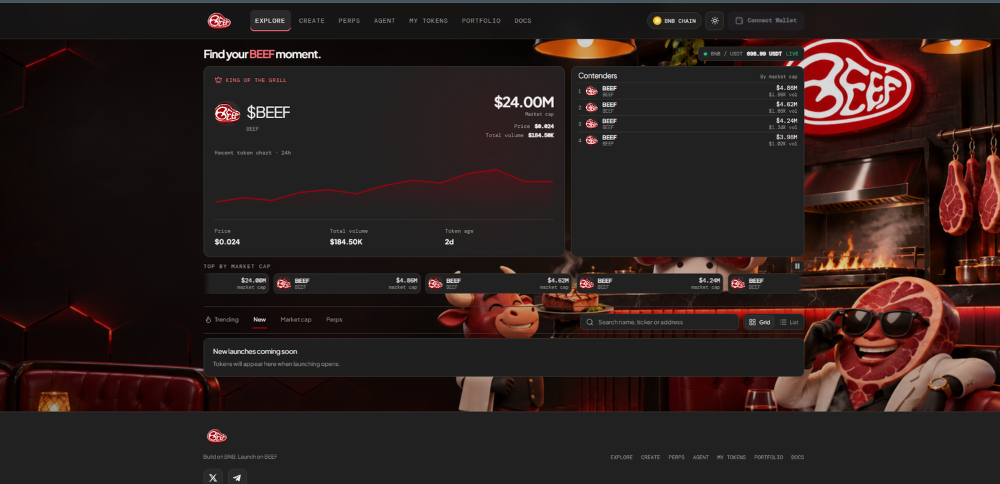

  

<h1 align="center">BEEF.family</h1>

  <strong>Build on BNB. Launch on BEEF.</strong> 
  A token launchpad and market discovery hub on BNB Chain.

  
  

  <a href="https://beef.family/">Visit BEEF.family</a> ·
  <a href="https://github.com/beefdotfamily/launchpad">GitHub Repository</a>

---

## Overview

**BEEF.family** is a BNB Chain launchpad and token discovery platform built to make launching and exploring on-chain projects straightforward. Discover tokens, follow market activity, connect your wallet, and access the platform's launch and trading tools from one place.

> **Find your BEEF moment.**

## Platform Preview

  

## Features

| Feature | Description |
| --- | --- |
| **Token Discovery** | Explore tokens and review market information such as price, market cap, volume, and token age. |
| **Token Launching** | Create and launch tokens on BNB Chain through the BEEF.family platform. |
| **No Bonding Curve** | No bonding curve to fill. |
| **No Graduation Target** | No graduation target to hit. |
| **Market Overview** | Follow token activity with market charts, rankings, and discovery views. |
| **Wallet Connection** | Connect a supported Web3 wallet to use wallet-enabled platform features. |
| **Perps & Agent** | Access the Perps and Agent areas from the main platform navigation. |
| **My Tokens & Portfolio** | View your token-related activity and portfolio from your connected account. |
| **Documentation** | Find platform information and usage guides in the Docs section. |

## Explore the Platform

The main navigation is organized around these areas:

- **Explore** — discover tokens, compare market activity, and browse trending or newly launched projects.
- **Create** — start a token launch on BNB Chain.
- **Perps** — access the platform's perps trading area.
- **Agent** — open the BEEF.family Agent area.
- **My Tokens** — view tokens associated with your activity.
- **Portfolio** — review your portfolio.
- **Docs** — read platform documentation and guides.

## Network

BEEF.family is designed for **BNB Chain**. Before confirming a transaction, check that your wallet is connected to the intended network and review the transaction details carefully.

## Getting Started

1. Visit [https://beef.family](https://beef.family).
2. Open the **Explore** page to browse tokens and market activity.
3. Connect your Web3 wallet when you want to use wallet-enabled features.
4. Confirm that your wallet is on BNB Chain before signing a transaction.
5. Use **Create**, **My Tokens**, **Portfolio**, and **Docs** to access the other platform areas.

## Development

This repository is the GitHub home for the BEEF.family launchpad. Developer setup instructions should match the source code and package scripts committed to this repository. Add the required runtime version, install command, environment-variable reference, and development/build commands here when the application source is published.

Never commit private keys, seed phrases, API secrets, or production environment files. Use an environment example file with placeholder values when documenting configuration.

## Security Notice

- Always verify that you are visiting the official website: **[https://beef.family](https://beef.family)**.
- Never share your wallet seed phrase or private key.
- Review every wallet prompt and transaction before signing.
- Interacting with tokens, DeFi applications, and smart contracts involves risk. Do your own research and only use funds you can afford to lose.

## Disclaimer

BEEF.family is a software platform. Information displayed by the platform may change and should not be treated as financial, investment, or trading advice. Users are responsible for their own wallet activity and transaction decisions.

---

  <strong>BEEF.family</strong> 
  Build on BNB. Launch on BEEF.

